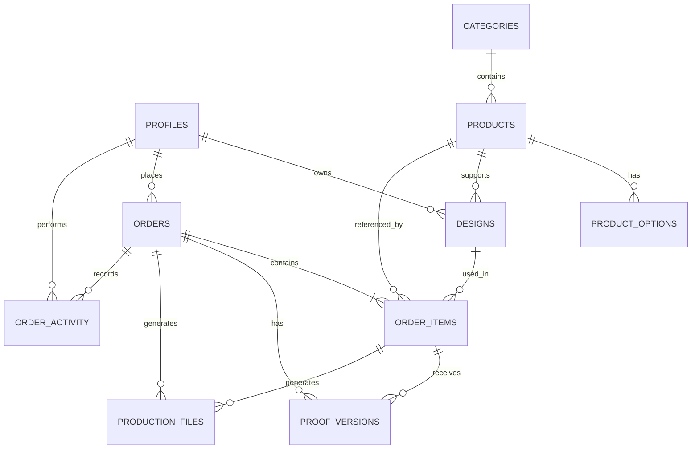

# Database Schema

## 1. Database

Database: PostgreSQL  
Provider: Supabase

Primary identifiers use UUID.

Timestamps use TIMESTAMPTZ.

## 2. Entity Relationships

## 3. Core Tables

### profiles
Stores customer and administrator profile information.

Important fields:
- id
- full_name
- email
- phone
- avatar_url
- role
- is_active
- created_at
- updated_at

### categories
Stores the six product divisions.

Important fields:
- id
- name
- slug
- description
- icon
- display_order
- is_active

### products
Stores product information and printing specifications.

Important fields:
- id
- category_id
- name
- slug
- division
- base_price
- currency
- default_width
- default_height
- dimension_unit
- print_dpi
- bleed_mm
- safe_margin_mm
- materials
- specifications
- image_url
- is_active
- is_featured

### product_options
Stores product-specific customization options.

Important fields:
- id
- product_id
- option_group
- option_name
- option_value
- price_adjustment
- metadata
- is_active

### designs
Stores customer designs and editor data.

Important fields:
- id
- customer_id
- product_id
- name
- canvas_width
- canvas_height
- canvas_unit
- design_data
- thumbnail_url
- source_file_path
- status

### orders
Stores the main order record.

Important fields:
- id
- order_number
- customer_id
- status
- payment_status
- subtotal
- discount_amount
- tax_rate
- tax_amount
- shipping_amount
- total_amount
- currency
- shipping_address
- billing_address
- estimated_completion_date
- completed_at

### order_items
Stores individual items within orders.

Important fields:
- id
- order_id
- product_id
- design_id
- product_name
- quantity
- width
- height
- material
- configuration
- unit_price
- discount_amount
- tax_amount
- line_total

### proof_versions
Stores immutable proof versions.

Important fields:
- id
- order_id
- order_item_id
- version_number
- proof_file_path
- preview_file_path
- status
- customer_feedback
- uploaded_by
- reviewed_by
- approved_at

### production_files
Stores references to generated production files.

Important fields:
- id
- order_id
- order_item_id
- customer_id
- file_name
- storage_path
- mime_type
- file_size
- format
- dpi
- width_mm
- height_mm
- generation_status

### order_activity
Stores order history and audit events.

Important fields:
- id
- order_id
- actor_id
- activity_type
- old_status
- new_status
- description
- metadata
- created_at

## 4. Required Additional Tables

The initial migrations do not yet create every table required by the full application.

Additional tables should include:

### pricing_quotes
- id
- customer_id
- quote_data
- subtotal
- discount_amount
- tax_amount
- total_amount
- currency
- expires_at
- status
- created_at

### payments
- id
- order_id
- customer_id
- gateway
- gateway_order_id
- gateway_payment_id
- amount
- currency
- status
- signature_verified
- created_at

### proof_revisions
- id
- proof_version_id
- customer_id
- message
- attachment_path
- created_at

### templates
- id
- product_id
- name
- template_data
- preview_path
- is_active

### variable_data_jobs
- id
- order_id
- template_path
- csv_path
- status
- total_rows
- successful_rows
- failed_rows
- output_path
- created_at

## 5. Storage Design

Files should be stored in private Supabase Storage buckets.

Suggested buckets:
- customer-artwork
- design-previews
- proof-files
- production-files
- variable-data
- product-images

Product images can be public if intended for storefront display.

Customer artwork, proofs, and production files must remain private.

## 6. Relationships and Constraints

- One profile can own multiple orders.
- One category can contain multiple products.
- One product can have multiple options.
- One order can contain multiple order items.
- One order can have multiple proof versions.
- One order can generate multiple production files.
- One order can contain multiple activity records.

## 7. Security

Row Level Security is enabled on application tables.

Customers can access only their own records.

Administrators can access operational records according to their permissions.

Production file metadata and storage objects must not be exposed directly to customers.

## 8. Migration Order

1. profiles
2. categories
3. products
4. product_options
5. designs
6. orders
7. order_items
8. proof_versions
9. production_files
10. order_activity
11. RLS policies
12. Additional business tables and policies

## 9. Data Integrity

- Use foreign keys.
- Use unique constraints for order numbers and slugs.
- Use check constraints for quantities, prices, and statuses.
- Store money using NUMERIC rather than floating-point types.
- Preserve proof history.
- Avoid deleting completed order records.
- Use database transactions for financial and order operations.
