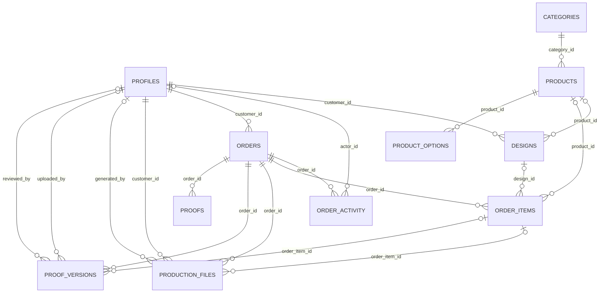

# Database Schema — Digital Heroes PrintForge

## 1. Database Overview

- **Database:** PostgreSQL
- **Provider:** Supabase
- **Schema:** `public`
- **Live tables verified:** 11
- **Identifier type:** UUID
- **Timestamp convention:** `TIMESTAMPTZ`
- **Flexible structured data:** `JSONB`
- **Monetary values:** `NUMERIC`
- **Default currency:** INR

This document describes the database structure retrieved from the live Supabase project's `information_schema` on 22 November 2026. It distinguishes existing database objects from proposed future extensions.

## 2. Live Entity Relationships

The following diagram reflects the foreign-key relationships retrieved from the live database.

**Relationship note:** `proofs.customer_id` and `proofs.approved_by` are columns in the live table, but the supplied foreign-key query did not report foreign-key constraints for them. The diagram therefore does not represent them as enforced relationships.

## 3. Existing Tables and Columns

The following sections document all columns returned by the live database query.

Notation:
- `NOT NULL` means the column is required.
- `NULL` means the column is nullable.
- `—` means no database default was reported.

### 3.1 profiles

Stores customer and administrator profile information.

| Column | Type | Nullable | Default |
|---|---|---|---|
| id | uuid | No | — |
| full_name | text | No | `''` |
| email | text | No | `''` |
| phone | text | Yes | — |
| avatar_url | text | Yes | — |
| role | text | No | `'customer'` |
| is_active | boolean | No | `true` |
| created_at | timestamptz | No | `now()` |
| updated_at | timestamptz | No | `now()` |

### 3.2 categories

Stores the product categories and print divisions.

| Column | Type | Nullable | Default |
|---|---|---|---|
| id | uuid | No | `gen_random_uuid()` |
| name | text | No | — |
| slug | text | No | — |
| description | text | Yes | — |
| icon | text | Yes | — |
| image_url | text | Yes | — |
| display_order | integer | No | `0` |
| is_active | boolean | No | `true` |
| created_at | timestamptz | No | `now()` |
| updated_at | timestamptz | No | `now()` |

### 3.3 products

Stores printable products, pricing, dimensions, and production specifications.

| Column | Type | Nullable | Default |
|---|---|---|---|
| id | uuid | No | `gen_random_uuid()` |
| category_id | uuid | No | — |
| name | text | No | — |
| slug | text | No | — |
| description | text | Yes | — |
| division | text | No | — |
| base_price | numeric | No | `0` |
| currency | character | No | `'INR'` |
| default_width | numeric | Yes | — |
| default_height | numeric | Yes | — |
| dimension_unit | text | No | `'mm'` |
| min_width | numeric | Yes | — |
| max_width | numeric | Yes | — |
| min_height | numeric | Yes | — |
| max_height | numeric | Yes | — |
| print_dpi | integer | No | `300` |
| bleed_mm | numeric | No | `3` |
| safe_margin_mm | numeric | No | `3` |
| materials | jsonb | No | `[]` |
| specifications | jsonb | No | `{}` |
| image_url | text | Yes | — |
| gallery_images | jsonb | No | `[]` |
| is_active | boolean | No | `true` |
| is_featured | boolean | No | `false` |
| sort_order | integer | No | `0` |
| created_at | timestamptz | No | `now()` |
| updated_at | timestamptz | No | `now()` |

### 3.4 product_options

Stores configurable options associated with products.

| Column | Type | Nullable | Default |
|---|---|---|---|
| id | uuid | No | `gen_random_uuid()` |
| product_id | uuid | No | — |
| option_group | text | No | — |
| option_name | text | No | — |
| option_value | text | No | — |
| price_adjustment | numeric | No | `0` |
| metadata | jsonb | No | `{}` |
| is_active | boolean | No | `true` |
| display_order | integer | No | `0` |
| created_at | timestamptz | No | `now()` |
| updated_at | timestamptz | No | `now()` |

### 3.5 designs

Stores customer-created designs and their editor configuration.

| Column | Type | Nullable | Default |
|---|---|---|---|
| id | uuid | No | `gen_random_uuid()` |
| customer_id | uuid | No | — |
| product_id | uuid | Yes | — |
| name | text | No | — |
| canvas_width | numeric | No | — |
| canvas_height | numeric | No | — |
| canvas_unit | text | No | `'mm'` |
| design_data | jsonb | No | `{}` |
| thumbnail_url | text | Yes | — |
| source_file_path | text | Yes | — |
| status | text | No | `'draft'` |
| created_at | timestamptz | No | `now()` |
| updated_at | timestamptz | No | `now()` |

### 3.6 orders

Stores customer orders, payment details, totals, and order status.

| Column | Type | Nullable | Default |
|---|---|---|---|
| id | uuid | No | `gen_random_uuid()` |
| order_number | text | No | — |
| customer_id | uuid | No | — |
| status | text | No | `'order'` |
| payment_status | text | No | `'pending'` |
| subtotal | numeric | No | `0` |
| discount_amount | numeric | No | `0` |
| tax_rate | numeric | No | `18` |
| tax_amount | numeric | No | `0` |
| shipping_amount | numeric | No | `0` |
| total_amount | numeric | No | `0` |
| currency | character | No | `'INR'` |
| shipping_address | jsonb | No | `{}` |
| billing_address | jsonb | No | `{}` |
| customer_notes | text | Yes | — |
| admin_notes | text | Yes | — |
| estimated_completion_date | date | Yes | — |
| completed_at | timestamptz | Yes | — |
| cancelled_at | timestamptz | Yes | — |
| cancellation_reason | text | Yes | — |
| created_at | timestamptz | No | `now()` |
| updated_at | timestamptz | No | `now()` |
| razorpay_order_id | text | Yes | — |
| razorpay_payment_id | text | Yes | — |

### 3.7 order_items

Stores individual products and configurations within an order.

| Column | Type | Nullable | Default |
|---|---|---|---|
| id | uuid | No | `gen_random_uuid()` |
| order_id | uuid | No | — |
| product_id | uuid | Yes | — |
| design_id | uuid | Yes | — |
| product_name | text | No | — |
| product_slug | text | Yes | — |
| quantity | integer | No | — |
| width | numeric | Yes | — |
| height | numeric | Yes | — |
| dimension_unit | text | No | `'mm'` |
| material | text | Yes | — |
| orientation | text | Yes | — |
| configuration | jsonb | No | `{}` |
| unit_price | numeric | No | `0` |
| discount_amount | numeric | No | `0` |
| tax_amount | numeric | No | `0` |
| line_total | numeric | No | `0` |
| artwork_path | text | Yes | — |
| created_at | timestamptz | No | `now()` |
| updated_at | timestamptz | No | `now()` |

### 3.8 proof_versions

Stores versioned artwork proofs and their review information.

| Column | Type | Nullable | Default |
|---|---|---|---|
| id | uuid | No | `gen_random_uuid()` |
| order_id | uuid | No | — |
| order_item_id | uuid | Yes | — |
| version_number | integer | No | — |
| proof_file_path | text | No | — |
| preview_file_path | text | Yes | — |
| status | text | No | `'pending'` |
| customer_feedback | text | Yes | — |
| admin_notes | text | Yes | — |
| uploaded_by | uuid | Yes | — |
| reviewed_by | uuid | Yes | — |
| reviewed_at | timestamptz | Yes | — |
| approved_at | timestamptz | Yes | — |
| created_at | timestamptz | No | `now()` |

### 3.9 proofs

Stores proof records, preview and file paths, revision notes, and approval information.

| Column | Type | Nullable | Default |
|---|---|---|---|
| id | uuid | No | `gen_random_uuid()` |
| order_id | uuid | No | — |
| customer_id | uuid | No | — |
| version | integer | No | `1` |
| preview_path | text | No | — |
| file_path | text | No | — |
| status | character varying | No | `'pending'` |
| revision_note | text | Yes | — |
| approved_at | timestamptz | Yes | — |
| approved_by | uuid | Yes | — |
| created_at | timestamptz | No | `now()` |
| updated_at | timestamptz | No | `now()` |

### 3.10 production_files

Stores generated production-file metadata and storage references.

| Column | Type | Nullable | Default |
|---|---|---|---|
| id | uuid | No | `gen_random_uuid()` |
| order_id | uuid | No | — |
| order_item_id | uuid | Yes | — |
| customer_id | uuid | No | — |
| file_name | text | No | — |
| storage_path | text | No | — |
| mime_type | text | No | — |
| file_size | bigint | No | — |
| format | text | No | — |
| dpi | integer | Yes | — |
| width_mm | numeric | Yes | — |
| height_mm | numeric | Yes | — |
| bleed_mm | numeric | Yes | — |
| generation_status | text | No | `'completed'` |
| generated_by | uuid | Yes | — |
| generated_at | timestamptz | No | `now()` |
| metadata | jsonb | No | `{}` |
| created_at | timestamptz | No | `now()` |

### 3.11 order_activity

Stores order-related activity and status-change history.

| Column | Type | Nullable | Default |
|---|---|---|---|
| id | uuid | No | `gen_random_uuid()` |
| order_id | uuid | No | — |
| actor_id | uuid | Yes | — |
| activity_type | text | No | — |
| old_status | text | Yes | — |
| new_status | text | Yes | — |
| description | text | No | — |
| metadata | jsonb | No | `{}` |
| created_at | timestamptz | No | `now()` |

## 4. Foreign-Key Relationships

The live database query returned the following 19 foreign-key relationships:

| Table | Column | References |
|---|---|---|
| designs | customer_id | profiles.id |
| designs | product_id | products.id |
| order_activity | actor_id | profiles.id |
| order_activity | order_id | orders.id |
| order_items | design_id | designs.id |
| order_items | order_id | orders.id |
| order_items | product_id | products.id |
| orders | customer_id | profiles.id |
| product_options | product_id | products.id |
| production_files | customer_id | profiles.id |
| production_files | generated_by | profiles.id |
| production_files | order_id | orders.id |
| production_files | order_item_id | order_items.id |
| products | category_id | categories.id |
| proof_versions | order_id | orders.id |
| proof_versions | order_item_id | order_items.id |
| proof_versions | reviewed_by | profiles.id |
| proof_versions | uploaded_by | profiles.id |
| proofs | order_id | orders.id |

## 5. Planned Future Extensions

The following tables were proposed as possible extensions in the original documentation. They were not present in the live `public` table list retrieved on 22 November 2026. They must not be treated as currently implemented tables.

### pricing_quotes
Potentially stores saved customer pricing calculations and quote expiry information.

### payments
Potentially stores normalized payment transactions, gateway references, and verification results.

### proof_revisions
Potentially stores individual customer revision requests and supporting attachments.

### templates
Potentially stores reusable product design templates.

### variable_data_jobs
Potentially tracks CSV-based variable-data generation jobs and their output files.

These tables should only be added to the live schema documentation after their migrations have been implemented and verified.

## 6. Storage Design

The database contains file-path and storage-reference columns for designs, artwork, proofs, and production files.

Potential Supabase Storage bucket organization:

| Bucket | Intended purpose |
|---|---|
| customer-artwork | Customer-uploaded artwork |
| design-previews | Design thumbnails and previews |
| proof-files | Proof documents |
| production-files | Final production-ready files |
| variable-data | Variable-data source and output files |
| product-images | Product images and gallery assets |

This is a proposed organization, not a verified inventory of existing Supabase Storage buckets.

Customer artwork, proofs, and production files should use private storage with authorization-controlled access. Public product images may use public access when appropriate.

## 7. Security and Access Control

The application uses Supabase Authentication for user identity and application authorization.

The application distinguishes customer and administrator roles. Backend authorization checks should be applied to protected administrative operations.

Database Row Level Security (RLS) policies and Storage policies must be reviewed in the Supabase dashboard or through SQL before claiming that every table and bucket has the intended access restrictions.

Recommended access rules:

- Customers should only access their own profile, designs, orders, and related files.
- Administrators should have authorized access to operational records.
- Payment secrets and Supabase service-role credentials must remain server-side.
- Private artwork, proof, and production files should not be exposed through unrestricted public URLs.

## 8. Data Integrity Considerations

- Use UUID identifiers for records.
- Maintain foreign-key relationships between related records.
- Use `NUMERIC` for monetary and dimensional values where precision matters.
- Use `JSONB` for configurable product, design, address, and metadata structures.
- Validate order quantities, dimensions, prices, and status transitions in the application and database.
- Preserve proof versions and order activity history.
- Protect completed order records from unintended deletion.
- Use server-side payment verification before marking payments as successful.

## 9. Migration and Deployment Notes

The live schema currently contains these 11 tables:

1. profiles
2. categories
3. products
4. product_options
5. designs
6. orders
7. order_items
8. proof_versions
9. proofs
10. production_files
11. order_activity

For future database changes:

1. Create or update migration files.
2. Apply migrations to the intended Supabase project.
3. Verify tables, columns, defaults, and constraints.
4. Verify foreign keys and indexes.
5. Review RLS and Storage policies.
6. Update this document to reflect the verified database state.

Never commit Supabase service-role keys, database passwords, or other private credentials to source control.
