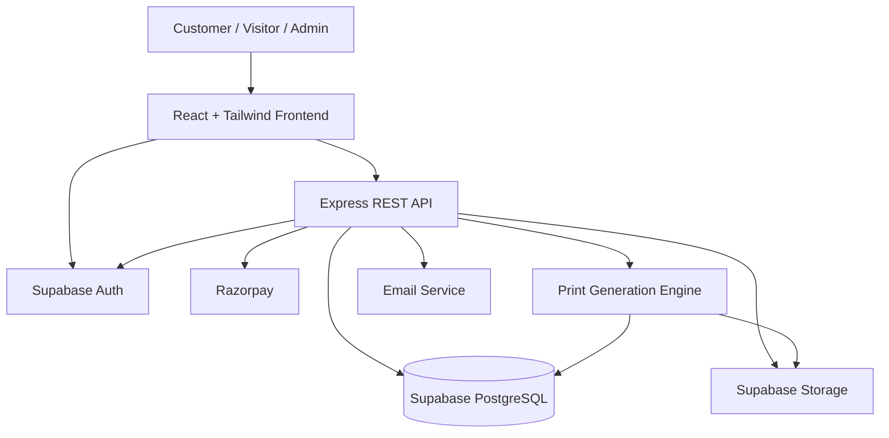

# System Architecture

## 1. Architecture Overview

Digital Heroes PrintForge uses a frontend/backend architecture with Supabase providing authentication, database, and storage services.

## 2. High-Level Architecture

## 3. Frontend Architecture

Technology:
- React
- Vite
- Tailwind CSS v4
- React Router
- Fabric.js
- Framer Motion

Responsibilities:
- User interface.
- Product browsing.
- Product configuration.
- Cart management.
- Design editing.
- Authentication interface.
- Checkout.
- Customer dashboard.
- Administration dashboard.

The frontend must never contain privileged Supabase credentials.

## 4. Backend Architecture

Technology:
- Node.js
- Express
- Supabase JavaScript client
- Joi validation
- Multer uploads

Responsibilities:
- API routing.
- Authentication verification.
- Authorization.
- Pricing calculations.
- Order creation.
- Payment processing.
- Proof version management.
- Production workflow.
- File processing.
- Notifications.
- Analytics.

## 5. Database Architecture

Supabase PostgreSQL stores:

- Profiles
- Categories
- Products
- Product options
- Designs
- Orders
- Order items
- Proof versions
- Production files
- Order activity

Additional tables are required for payments, pricing quotes, templates, proof revisions, and variable-data jobs.

## 6. Authentication Flow

1. Customer registers using Supabase Auth.
2. Supabase creates an authentication user.
3. A database trigger creates the corresponding profile.
4. The frontend receives an access token.
5. The frontend sends the token in the Authorization header.
6. Express verifies the token through Supabase Auth.
7. Backend authorization checks the user's database role.
8. The request proceeds only if the user has permission.

Admin roles must be assigned through trusted administrative operations.

## 7. Product Ordering Flow

1. Customer selects a product.
2. Customer configures dimensions and materials.
3. Frontend requests a pricing quote.
4. Backend validates the configuration.
5. Backend calculates and stores the quote.
6. Customer adds the configured product to the cart.
7. Customer submits the order.
8. Backend validates quote ownership and expiry.
9. Backend creates the order and order items.
10. Customer completes payment.

## 8. Proof Workflow

1. Customer submits artwork.
2. Administrator reviews artwork.
3. Administrator generates or uploads a proof.
4. Backend creates a new proof version.
5. Customer reviews the proof.
6. Customer approves or requests changes.
7. A revision request is recorded.
8. A new proof version is created when revised artwork is submitted.
9. Production becomes eligible only after the latest required proof is approved.

## 9. Production Workflow

1. Backend verifies payment.
2. Backend verifies the approved proof.
3. Production job is queued.
4. Artwork is downloaded from private storage.
5. Artwork is parsed and validated.
6. Resolution and print dimensions are checked.
7. Bleed is calculated.
8. PDF or PNG output is generated.
9. Generated files are uploaded to private storage.
10. Production metadata is recorded.
11. Administrator downloads the files.

## 10. Security Boundaries

### Frontend
- Public Supabase anonymous key only.
- No Razorpay secret.
- No service-role key.
- No direct production file access.

### Backend
- Validates user access tokens.
- Checks ownership and role.
- Calculates prices.
- Verifies payment signatures and amounts.
- Controls proof approval.
- Controls production generation.
- Generates authorized signed URLs where appropriate.

### Database
- Row Level Security enabled.
- Customer data isolated.
- Admin operations restricted.
- Sensitive operations performed through trusted backend code.

## 11. Deployment Architecture

Frontend:
- Vercel

Backend:
- Node-compatible cloud hosting

Database and storage:
- Supabase

Payments:
- Razorpay

Production files:
- Private Supabase Storage buckets

## 12. Important Design Principle

The frontend is not a trusted environment.

All financial calculations, payment verification, ownership checks, workflow transitions, and production permissions must be enforced by the backend.
